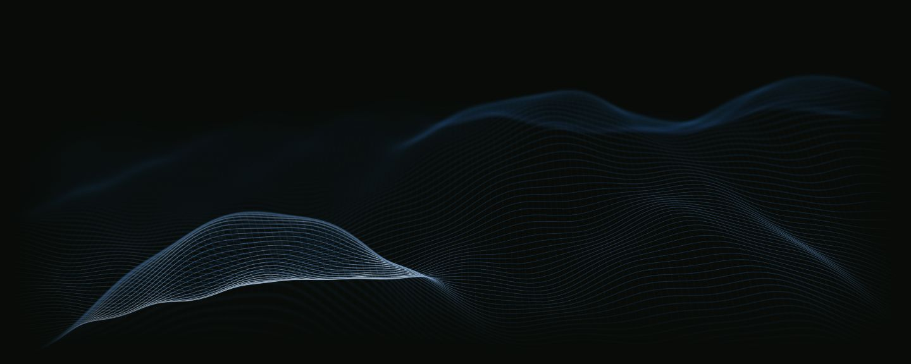

# Wavefield

Interactive procedural wire terrain for the web, built with React, Motion, TypeScript, and native WebGPU. An independent [LibreCosta](https://github.com/librecosta) project.



*Captured from the running demo at 1440 × 576, time = 8 seconds, with the default scene and full grid. No image textures are used by the renderer.*

## Features

- Continuous terrain with slowly drifting hills and a complete two-direction grid.
- Gaussian soft lines, depth-dependent focus, and localized grazing highlights.
- Live scene, material, framing, and playback controls; reproducible frozen frames.
- Transparent, premultiplied-alpha canvas and a responsive stage.
- Static CSS fallback when WebGPU is unavailable or the device is lost, with explicit retry.

## Quick start

Requires **Node.js 24+** and npm.

```sh
npm ci
npm run dev
```

Open the local URL printed by Vite. For the production build:

```sh
npm run build
npm run preview
```

This repository is a standalone demo, not a published npm package. Build output is in `dist/`; retain its generated `LICENSE` and `THIRD_PARTY_NOTICES.md` when distributing it. The demo has no runtime external service or asset requests.

## Controls

Open **Controls** or press **D**. Adjust hill positions, heights and spans; focus, defocus, grid alphas and grazing light; field framing, time and sampling. **Space** toggles playback, **R** restarts time, and **Escape** closes controls. **Initial frame** restores defaults and pauses at zero. **Freeze at time** pauses at an exact animation time. Scene seeds create deterministic alternatives; **Article reference preset** restores the default hills and phase.

Append these queries to the local demo URL:

| Query | View |
| --- | --- |
| `?inspect=1&still=1&time=8` | Responsive stage with controls, frozen at 8 seconds |
| `?capture=1440x576&still=1&time=8&quality=reference` | Reproduce the preview, with controls hidden |
| `?capture=390x422&still=1&time=8&quality=reference` | Small-screen static frame with the full grid |
| `?capture=1&still=1&time=8&quality=reference` | 1891 × 230 comparison frame |

Capture mode uses a fixed CSS size and may overflow smaller windows. Ordinary pages use a responsive stage. Time zero shows settled geometry; **Entrance fade** optionally adds the 1.2-second reveal.

## Browser and performance notes

WebGPU requires an enabled browser implementation, an available adapter, and **HTTPS or localhost**. The app also uses modern ES modules, `ResizeObserver`, `IntersectionObserver`, and CSS viewport units. Hardware checks use a local Chromium-based browser with an AMD GCN-5 adapter; other browsers, drivers and physical mobile devices are not certified.

Motion schedules callbacks; actual GPU submissions are capped at **24/s by default**, with a 12/s option. This is a maximum, not a guaranteed frame rate. Pause, reduced motion, hidden documents and offscreen views stop continuous rendering and time advancement; parameter and size changes can request a static redraw. Returning excludes inactive time. Diagnostics report submissions and synchronous **CPU encoding/submission cost**, not GPU execution time.

The renderer uses one shared-node compute pass and one instanced ribbon pass, without a depth attachment. Full quality draws 43,008 segments (192 × 112 cells); adaptive quality draws 24,576 below 560 CSS pixels. DPR is capped at 1.5 and backing dimensions respect device limits. No Three.js or rendering framework is used.

## Development

```sh
npm run check
```

Runs TypeScript checks, the test suite, and a production build. Tests cover terrain derivatives, projection, optical behavior, scheduling and GPU lifecycle contracts. Real-browser checks are still needed for shader compilation and visual output. `npm run typecheck` and `npm test` are also available separately.

## Credits and license

Copyright © 2026 LibreCosta. Wavefield-authored code is licensed under [BSD-3-Clause](LICENSE); dependencies retain their own licenses.

The visual behavior and default numeric scene were informed by [Motion's article header terrain](https://motion.dev/examples/react-particle-orb). Wavefield is independently written and is not an official or endorsed Motion project. Motion's MIT package license must not be assumed to license its website's header implementation or scene design. See [third-party notices and reference provenance](THIRD_PARTY_NOTICES.md) for the distinction and remaining permission uncertainty; research details are in [Issue #2](https://github.com/librecosta/wavefield/issues/2).
